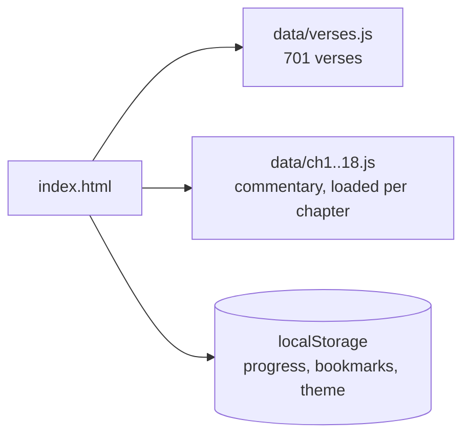

<p align="center">
  
</p>

<p align="center">
  <a href="https://k4hav.github.io/gita-library/"></a>
  
  
  
</p>

<p align="center"><i>Read the Gita simply, calmly, and in the language you are most comfortable with.</i></p>

<p align="center"></p>

## What is this?

A calm, modern reading site for the **Bhagavad Gita**: all 18 chapters and 701 shlokas, in sequence, with the meaning and a detailed explanation for every verse. Built with a minimal, calm design, hand-drawn line illustrations and a reading-first layout, so anyone can read it comfortably on phone or desktop. No audio, no ads, no login, no backend.

## Languages

| Tab | What you get | Source |
|---|---|---|
| **Sanskrit** | Original Devanagari verse + Roman transliteration | Traditional text |
| **Hindi** | Hindi translation + detailed commentary | Swami Ramsukhdas |
| **Hinglish** | Hindi converted to Roman script, automatically | Generated in the browser |
| **English** | English translation + commentary | Swami Sivananda |

> Hinglish is an automatic Roman conversion of the Hindi text, so a spelling may sometimes differ from what you would type yourself.

## Features

- **18 chapter cards**, each with its theme, illustration and a live progress bar
- **Search** (press `/`): by shloka number (`2.47`), chapter (`chapter 4`), or any word in Sanskrit, Hindi, Hinglish or English (`karma`, `peace`, `fear`)
- **Language tabs** (English first, then Hindi and Hinglish) with a sliding pill, English word meanings tucked into a collapsible block, and expandable long explanations
- **Resume reading**: your last shloka, read count, recent verses and bookmarks stay in your browser
- **Themes**: System, Light and Dark, remembered between visits
- **Reading comfort**: adjustable font size, copy shloka, keyboard navigation
- **Minimal design**: chapter-wise line-art illustrations that draw themselves, and a "how are you feeling today?" section that opens a fitting shloka (anxiety, grief, anger, restless mind, confusion, self-growth)
- **Accessible**: keyboard friendly, visible focus, respects *reduced motion*

<p align="center"></p>

## Keyboard shortcuts

| Key | Action |
|---|---|
| `/` | Open search |
| `Esc` | Close search |
| `←` `→` | Previous / next shloka |
| `↑` `↓` `Enter` | Move through and open search results |

## Run it

No build step, no dependencies.

```bash
git clone https://github.com/k4hav/gita-library.git
cd gita-library
npx serve .        # or just open index.html
```

### Deploy free on GitHub Pages

1. Push the repo to GitHub (public).
2. Go to **Settings → Pages**.
3. Choose **Deploy from a branch**, branch `main`, folder `/ (root)`.
4. Your site goes live at `https://<your-username>.github.io/<repo-name>/`.

## How it works



<details>
<summary><b>Project structure</b></summary>

```
gita-library/
├── index.html          # the whole UI (HTML + CSS + JS)
├── assets/             # animated README graphics
├── data/
│   ├── verses.js       # chapters + all verses + source names
│   └── ch1.js … ch18.js  # commentary, loaded only when a chapter opens
├── LICENSE
└── README.md
```
</details>

<details>
<summary><b>What is saved in your browser</b></summary>

Everything is stored locally under keys starting with `gita:` (`theme`, `fs`, `lg`, `last`, `read`, `rc`, `bm`). Nothing is sent anywhere. Use the **Reset saved progress** button at the bottom of the reader to clear it. Progress is per browser and per device.
</details>

## Roadmap

- [x] All 701 shlokas with four languages and commentary
- [x] Search, bookmarks, progress and themes
- [ ] Optional login and cross-device sync (Supabase, free plan is enough)
- [ ] Daily shloka and reading history page
- [ ] More translations and word-by-word meanings

## Credits and licence

- **Data**: [gita/gita](https://github.com/gita/gita) open dataset (Unlicense). Sanskrit is the traditional text. Hindi translation and commentary are by Swami Ramsukhdas; English translation and commentary are by Swami Sivananda. Please keep this attribution.
- **Code**: [MIT](LICENSE).
- The Hindi translation and commentary may still be under copyright held by their publishers, so check before any commercial use.
- The explanations are study aids from the named authors. This project does not invent or alter scripture.

<p align="center"></p>
<p align="center"><sub>कर्मण्येवाधिकारस्ते मा फलेषु कदाचन ॥ Keep reading, keep doing.</sub></p>
